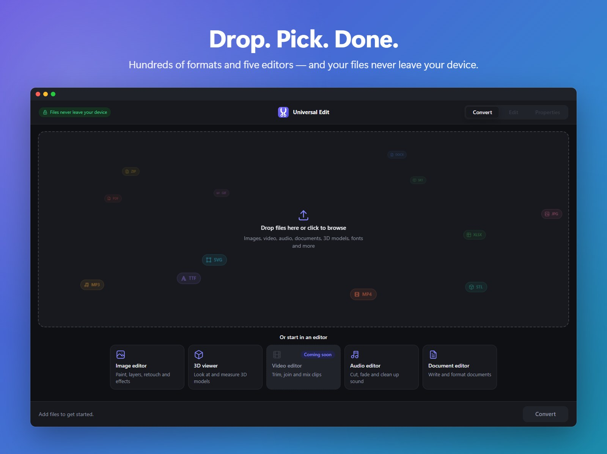
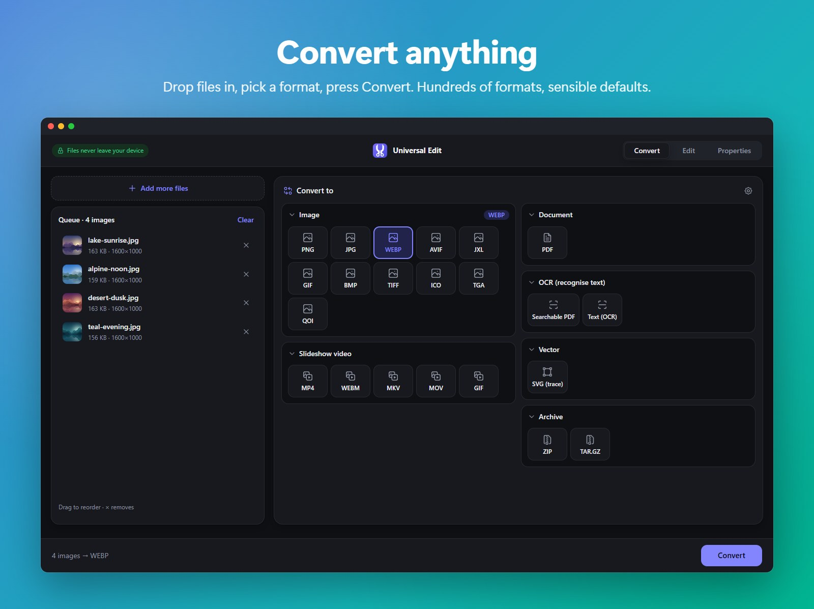
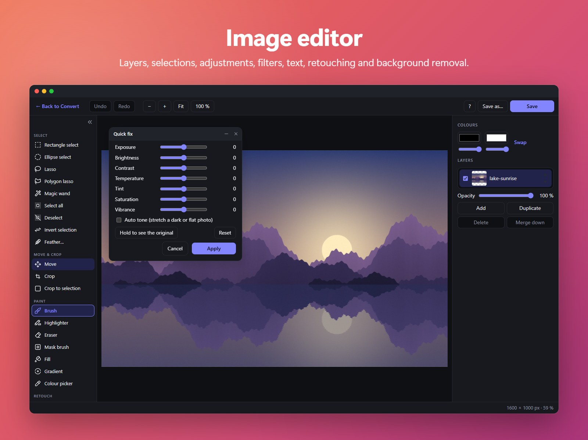
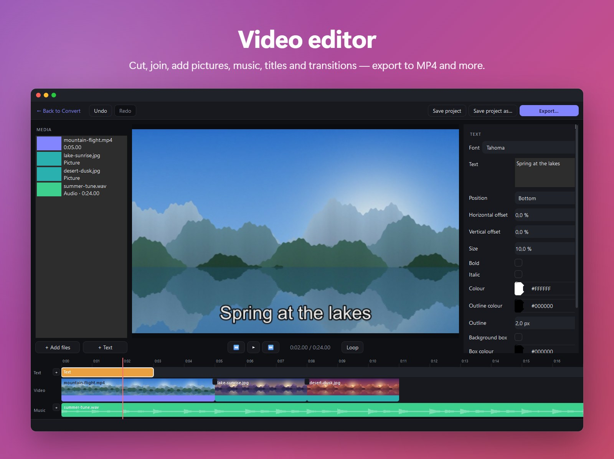
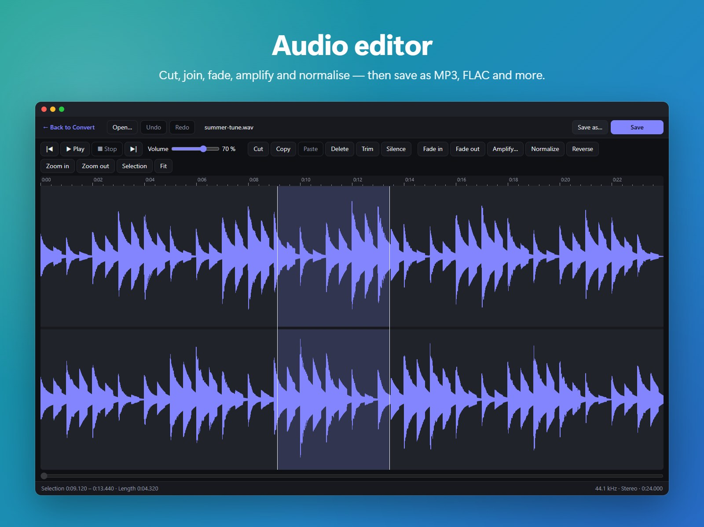
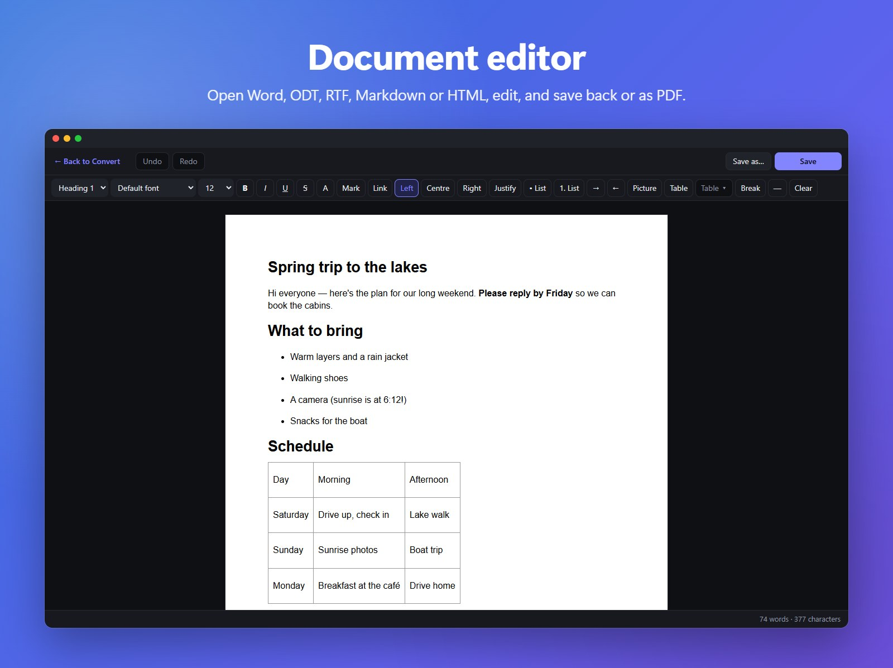
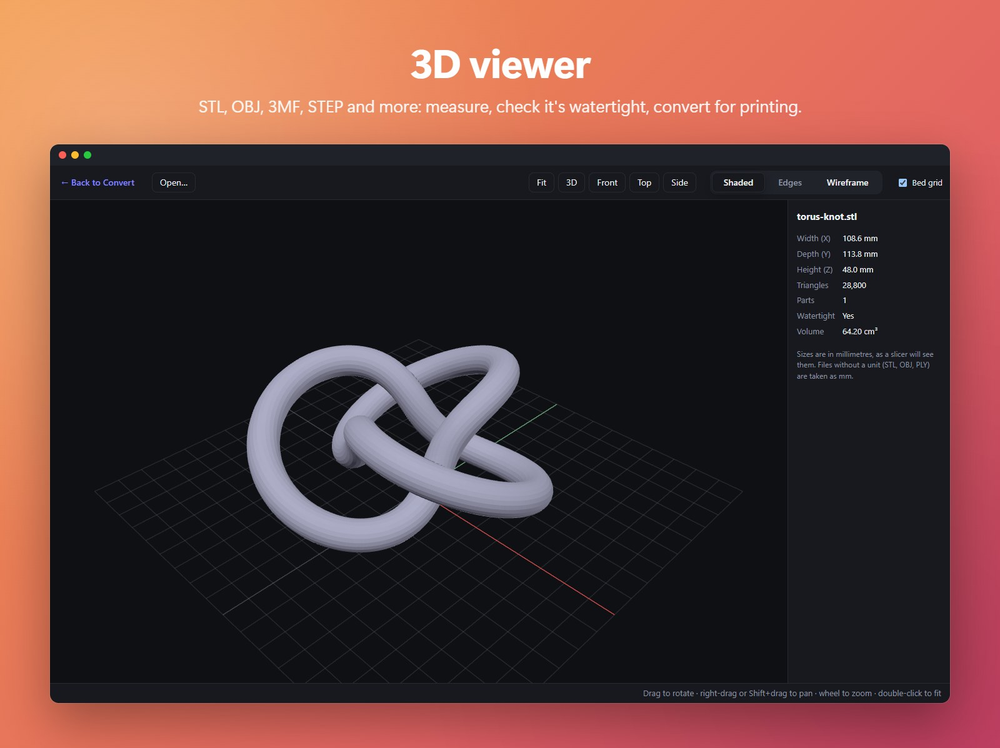
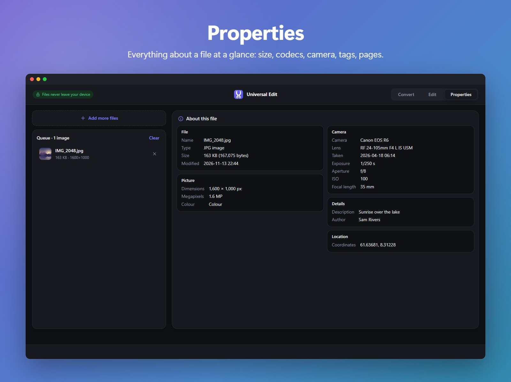

<div align="center">


# Universal Edit

**Convert and edit pictures, video, music, documents, 3D models and more — on your own device.**

Free and open source · nothing is uploaded · works in your browser (a Windows app is on the way)

### [▶ Open it in your browser](https://darkbepo.github.io/Universal-Edit/) &nbsp;·&nbsp; [⬇ Windows app](https://github.com/darkbepo/Universal-Edit/releases)



</div>

<sub>(Formerly *Universal Media Converter*.)</sub>

## Why Universal Edit?

- 🔒 **Private by design.** Your files never leave your device. The website does all its work
  inside your browser; the desktop app works offline.
- 🧰 **One tool instead of ten.** Convert between hundreds of formats, then touch things up in
  the built-in image, video, audio and document editors.
- 🎯 **Simple first, powerful when you need it.** Drop files in, pick a format, press
  **Convert** — the defaults are sensible. Every setting is there if you want it.
- 💸 **Free, forever.** Open source (AGPL-3.0), no accounts, no watermarks, no limits on how
  many files you convert.

## A quick tour



**Convert** — drop in one file or a hundred. Universal Edit works out what they are and shows
only the formats they can become, grouped into cards. Each file gets its own progress bar.

<table>
<tr>
<td width="50%"></td>
<td width="50%"></td>
</tr>
<tr>
<td><b>Image editor</b> — layers, selections of any shape, adjustments, filters, editable
text and shapes, clone stamp, content-aware fill and one-click background removal.</td>
<td><b>Video editor</b> <i>(desktop)</i> — cut, split and join clips, add pictures, music,
titles and transitions, preview with sound, export to MP4, WebM, GIF and more.</td>
</tr>
<tr>
<td></td>
<td></td>
</tr>
<tr>
<td><b>Audio editor</b> — a simple, Audacity-style editor: cut, paste, fade, amplify,
normalise and reverse, then save as MP3, FLAC, WAV and more.</td>
<td><b>Document editor</b> — open Word, ODT, RTF, Markdown, text or HTML, edit with
headings, lists, tables and pictures, and save back or as PDF.</td>
</tr>
<tr>
<td></td>
<td></td>
</tr>
<tr>
<td><b>3D viewer</b> — look at STL, OBJ, 3MF, STEP and more from every side; see the size in
mm, the volume and whether it's watertight before you print.</td>
<td><b>Properties</b> — everything about a file at a glance: size and dates, camera and
lens, codecs and tags, pages and authors.</td>
</tr>
</table>

## What it can do

Each area below has a short explanation and a fold-out list that shows exactly what works in
the **desktop app** and on the **website**.

✅ works · ❌ not yet · — not possible there (the reason is given)

### 🖼️ Pictures

Turn any picture into any other format — from everyday PNG, JPG and WEBP to iPhone HEIC,
modern AVIF / JPEG XL, camera RAW files and Photoshop PSD. Shrink photos to a target size, make
a slideshow video or an animated GIF from several pictures, or put them all into one PDF.

<details>
<summary>Picture formats in detail</summary>

| Feature | Desktop app | Website |
|---|:---:|:---:|
| Images ↔ each other (PNG, JPG, WEBP, AVIF, HEIC, GIF, BMP, TIFF, ICO…) | ✅ | ✅ |
| Save as HEIC | ✅ | ❌ |
| Save as JPEG XL (JXL) | ❌ | ✅ |
| Camera RAW (CR2, CR3, NEF, ARW, DNG, RAF, ORF, RW2…) and Photoshop PSD as input | ✅ | ✅ |
| Images → slideshow video / animated GIF / PDF | ✅ | ✅ |
| Compress to a target size | ✅ | ✅ |
| Layered projects: save and open OpenRaster `.ora` (GIMP and Krita open it too); `.ora` → any image format | ✅ | ✅ |

</details>

### 🎬 Video & GIF

Change a video's format, codec, size, frame rate or quality; trim it, speed it up, rotate it,
or squeeze it to a target size for sharing. Pull out the sound as MP3, grab still frames, or
turn a clip into a GIF.

<details>
<summary>Video in detail</summary>

| Feature | Desktop app | Website |
|---|:---:|:---:|
| Video ↔ each other (MP4, MKV, MOV, WEBM, AVI…) | ✅ | ✅ |
| Video codecs H.264 · VP8 · MPEG-4 | ✅ | ✅ |
| Video codecs VP9 · AV1 | ✅ | ✅ (browser encoder) |
| Video codec H.265 / HEVC | ✅ | ✅ where the device has an encoder (most Windows/Mac/phones; not Linux) |
| Video → GIF · frames (N per 30) · audio only | ✅ | ✅ |
| Compress to a target size | ✅ | ✅ |
| Very large videos (several GB) | ✅ | ❌ |

The desktop app converts video much faster: it can use your whole processor, the browser only a
few threads.

</details>

### 🎵 Music & audio

Convert between all the common audio formats, pick the bitrate, or shrink a recording to a
target size.

<details>
<summary>Audio in detail</summary>

| Feature | Desktop app | Website |
|---|:---:|:---:|
| Audio ↔ each other (MP3, WAV, FLAC, M4A, OGG, AIFF, WMA…) | ✅ | ✅ |
| Compress to a target size | ✅ | ✅ |

</details>

### 📄 Documents & PDF

Convert between Word, OpenDocument, RTF, Markdown, HTML, EPUB, text and PDF. Everything you'd
want to do with a PDF is here too: merge, split, compress, rotate, reorder pages, add or remove
a password, turn it into pictures — or back into an editable Word file. Scanned pages and
photos of text become searchable with OCR in 30 languages.

<details>
<summary>Documents and PDF in detail</summary>

| Feature | Desktop app | Website |
|---|:---:|:---:|
| Documents ↔ each other (DOCX, ODT, RTF, TXT, Markdown, HTML, EPUB, PDF) | ✅ | ✅ |
| Old Office formats (DOC, XLS, PPT) and ODS / ODP | ✅ | ❌ (needs LibreOffice: ~250 MB, too big for the website for now) |
| Spreadsheets & slides as input (XLSX, CSV, PPTX) | ✅ | ✅ |
| Save as PowerPoint (PPTX) | ❌ | ✅ |
| Documents → images (one per page) | ✅ | ✅ |
| PDF: page range, paper size, margins, split | ✅ | ✅ |
| PDF: merge, compress, rotate, add / remove password, reorder / delete pages | ✅ | ✅ |
| PDF → Word (DOCX / ODT / RTF) keeping the layout: tables, columns, pictures | ✅ | ❌ (text only) |
| OCR (scanned PDF / photo → searchable PDF or text, 30 languages) | ✅ | ✅ |
| eBooks: save as MOBI / AZW3 (Kindle), read Kindle books (one-click Calibre install) | ✅ | — (Calibre has no browser version) |

</details>

### 🧊 3D printing & CAD

Convert 3D models between the formats slicers and design programs use — STL, OBJ, 3MF, PLY,
GLB and engineering STEP / IGES — always measured in millimetres. Turn DXF / DWG drawings into
PDF, SVG or pictures.

<details>
<summary>3D and CAD in detail</summary>

| Feature | Desktop app | Website |
|---|:---:|:---:|
| 3D models: STL, OBJ, 3MF, PLY, GLB, STEP / IGES | ✅ | ✅ |
| CAD drawings: DXF → SVG, PNG, JPG (layer colours or print black-on-white) | ✅ | ✅ |
| CAD drawings: DWG in (one-click LibreDWG install), → PDF on paper sizes, save as another DXF version | ✅ | ❌ |

</details>

### 🗂️ Vector graphics, fonts, subtitles, data & archives

The odds and ends that usually need five different websites: SVG / AI / EPS artwork, tracing a
picture into a vector, web fonts and font subsets, subtitle files (and burning them into a
video), JSON / CSV / XML / YAML / Excel data, and ZIP / 7Z / RAR archives.

<details>
<summary>All of these in detail</summary>

| Feature | Desktop app | Website |
|---|:---:|:---:|
| Vector: SVG / AI → PNG, JPG, WEBP, TIFF · AI → SVG / PDF · PDF pages → SVG | ✅ | ✅ |
| Vector: trace images into SVG (colour or black & white) | ✅ | ✅ |
| Vector: SVG → PDF, EPS / PostScript in and out | ✅ | ❌ |
| Fonts: TTF / OTF ↔ WOFF ↔ WOFF2 · subset (Latin, Cyrillic, Greek or your own characters) | ✅ | ✅ |
| Fonts: TTF ↔ OTF (changes the outline type) | ✅ | ❌ |
| Subtitles: SRT ↔ VTT ↔ ASS ↔ TTML ↔ LRC, shift timing, fix old encodings · extract from video · burn in · add as track | ✅ | ✅ |
| Data: JSON ↔ CSV ↔ TSV ↔ XML ↔ YAML ↔ XLSX | ✅ | ✅ |
| Archives: open ZIP, 7Z, RAR, TAR(.GZ/.XZ/.BZ2) · extract · repack · pack any files | ✅ | ✅ |
| Archives: create 7Z, password-protect (AES-256) | ✅ | ❌ |
| Code and text files: CSS, JS, TS, Python, C / C++, C#, Java, Go, Rust, PHP, shell / PowerShell / batch scripts, SQL, INI / TOML / .env, Dockerfile, .gitignore and other plain text are accepted · packed into ZIP / 7Z / TAR.GZ · shown in the viewer · edited in the code editor | ✅ | ✅ (no 7Z, no viewer) |

</details>

### 🎨 Image editor

A Photoshop-light editor that opens with **Edit** after you add pictures, or from the start
screen with a new blank picture. Work in layers, select any shape, fix colours, apply looks and
filters, add text, arrows and stickers, retouch with the clone stamp or content-aware fill, and
remove a background in one click. Save as any picture format, or as a layered `.ora` file.

<details>
<summary>Image editor in detail</summary>

| Feature | Desktop app | Website |
|---|:---:|:---:|
| Basics: layers (opacity, hide, reorder, merge), brush, eraser, fill, colour picker, shapes, text, crop, resize, rotate / flip, undo | ✅ | ✅ |
| Layers: select several (Ctrl / Shift+click), drag to reorder, ▲▼ arrows on each layer, right-click menu (duplicate, delete, merge, move to top / bottom, show / hide); Alt+click an eye shows only that layer | ✅ | ✅ |
| Crop: a small bar next to the crop rectangle (or a rectangle selection) shows the size with Apply crop / Cancel (Crop to selection / Deselect) | ✅ | ✅ |
| Clipboard: copy (Ctrl+C), copy what you see (Ctrl+Shift+C), cut, paste as a new layer — back in place, or centred for pictures from other programs | ✅ | ✅ (copying into other programs needs a browser that allows it) |
| Move tool (V): drag the selected layers, arrow keys nudge · layer shortcuts · a "?" list of every shortcut | ✅ | ✅ |
| Adjust: Quick fix (exposure, brightness, contrast, temperature, tint, saturation, vibrance, auto tone), Levels, Curves — live preview, "hold to see the original" | ✅ | ✅ |
| Filters: Blur, Sharpen, 11 one-click Looks (warm, cool, vivid, black & white, noir, sepia, faded, vintage, dramatic, matte, bright & airy) with strength | ✅ | ✅ |
| Selections: rectangle / ellipse (M), lasso / polygon lasso (Q), magic wand (W); Shift adds, Alt subtracts; invert, feather; drag inside to move the outline — every tool, adjustment and filter follows it | ✅ | ✅ |
| Masks and gradients: layer masks with a Mask brush (K), Gradient tool (colour, layer mask or soft selection — e.g. brighten only the sky), Background blur for portraits | ✅ | ✅ |
| Text: text layers stay editable and are drawn live while you type; alignment, outline, drop shadow, background box, watermark across the picture | ✅ | ✅ |
| Shape layers: each line, arrow, rectangle and ellipse is its own layer with handles to reshape it any time; Rasterize layer makes it plain pixels | ✅ | ✅ |
| Annotation: arrow tool, highlighter (H), 11 built-in stickers (check mark, star, speech bubble, map pin…; CC0) | ✅ | ✅ |
| Layer effects: drop shadow, glow, outline and colour overlay — live and editable (fx badge in the layers list) | ✅ | ✅ |
| Retouching: clone stamp (S) and content-aware fill (paints over blemishes, wires, small objects) | ✅ | ✅ |
| Background removal: hides the background with a layer mask you can touch up; the model is downloaded once (desktop ~179 MB, website ~80 MB) | ✅ | ✅ |
| Pasteboard: parts of layers moved past the edge stay visible (faded) and can be moved back | ✅ | ✅ |
| Workspace: grouped tool rail (names or icons only), every tool's options and setting in a floating window you can drag, minimise or keep open; positions remembered | ✅ | ✅ |

</details>

### ✂️ Video, audio & document editors and the 3D viewer

The other editors open the same way: add files and press **Edit**, or pick a tile on the start
screen to begin with an empty one.

<details>
<summary>The other editors in detail</summary>

| Feature | Desktop app | Website |
|---|:---:|:---:|
| **Video editor**: cut, split, trim, reorder, join · pictures · music rows · text titles · transitions (crossfade, fade through black, wipes, slides) · speed, volume, fades, rotate / flip / crop, brightness / contrast / saturation · preview with sound · export to MP4, MKV, WebM, MOV, AVI or GIF · project files (.umcvideo) | ✅ | coming later |
| **Audio editor** (laid out like a simple Audacity): several files joined end to end · waveform per channel with a time ruler, zoom and scroll · play / pause / stop with a volume slider · cut, copy, paste, delete, trim to the selection, silence, fade in / out, amplify (dB), normalize (−1 dB), reverse · undo / redo · save as MP3, M4A, WAV, FLAC, OGG, OPUS, AIFF, WMA or AC-3 | ✅ (≈ 45 min of stereo at most) | ✅ (≈ 15 min of stereo at most) |
| **Document editor**: one DOCX, ODT, RTF, DOC, Markdown, TXT or HTML file · headings, fonts, colours, highlight, lists, tables, pictures, links, page breaks · find & replace · undo · save back or as PDF and every document format | ✅ | ✅ (DOC needs the desktop app) |
| **3D viewer**: STL, OBJ, 3MF, PLY, GLB, OFF, STEP, IGES · rotate / pan / zoom, front / top / side / 3D views, shaded / edges / wireframe, print-bed grid · size in mm, triangles, parts, watertight check, volume | ✅ | ✅ (no OFF) |
| **Code editor** (quick edits, Notepad++ style): a tab per file · colours for 40+ languages, line numbers, matching brackets · find & replace (match case, whole word, patterns) · Tab / Shift+Tab on lines, comment / uncomment (Ctrl+/), auto-indent, go to line, word wrap, zoom · status bar with line / column, language, encoding (UTF-8, UTF-16, Windows-1252, BOM) and line endings · saves byte for byte (an untouched file stays identical), asks before overwriting a file another program changed · JSON / YAML / XML mistakes underlined with a plain-language note (click it to jump there) · Tidy lays out JSON / XML neatly (one undo step) · Preview: Markdown beside the code, HTML in your browser | ✅ | ✅ (New = Alt+N, close tab = Alt+W, next / previous tab = Alt+PageDown / PageUp: the browser keeps Ctrl+N / W / Tab; Save downloads, or "Save to a file…" on Chrome / Edge; the HTML and Markdown preview shows beside the code, or instead of it on phones) |
| **Start screen tiles** (three per row, big icon on the left): open the image editor (new picture: size presets, white / transparent / black), the 3D viewer, the audio editor, the video editor, the document editor (a new "Untitled" document) or the code editor (a new "Untitled" file) without a file | ✅ | ✅ (video editor: "Coming soon") |

</details>

### 🔍 Properties & viewer

See what's inside a file before you do anything with it, and (on Windows) open files in a fast
viewer that knows almost every format.

<details>
<summary>Properties and viewer in detail</summary>

| Feature | Desktop app | Website |
|---|:---:|:---:|
| **Properties** (Convert \| Edit \| Properties): size and dates · pictures: dimensions, colour, camera, lens, exposure, date taken, author, location · video / music: length, codecs, frame rate, channels, track languages, tags, cover picture · PDF / Office: pages, words, page size, title, author · fonts: family, style, glyphs, variable axes · 3D models: size, triangles, watertight · read-only for now; changing details is next | ✅ | ✅ (no folder; subtitle tracks and AVI / WMV / FLV details desktop only) |
| **Change photo details** (Properties, JPG / PNG / WebP): title, comments, author, copyright, tags, date taken, rotation · remove the location or every hidden detail · several pictures at once ("Several values" stay as they are) · only the details are rewritten, never the picture; old values are wiped from the file · desktop: save into the original (asks once) or as a copy, keeps the modified date · website: downloads the changed picture (a ZIP for several) | ✅ | ✅ (download) |
| **Viewer** (for "Open with"): pictures (zoom / pan, animated GIFs), video and music with sound, PDF / EPUB / SVG pages, Word / Excel / PowerPoint / EPS / DXF as pages, text, 3D models · the folder's other files beside it (← / →) · **Convert** / **Edit** buttons · one window reused | ✅ | — |

</details>

### 🪟 On your computer

<details>
<summary>Installing, right-click menu and everyday comfort</summary>

| Feature | Desktop app | Website |
|---|:---:|:---:|
| Files never leave your computer | ✅ | ✅ |
| No install needed | ❌ | ✅ |
| Save straight into a folder | ✅ | ✅ Chrome/Edge · ❌ Firefox/Safari (zip instead) |
| **Windows installer** (per user, no admin) · right-click **"Convert with Universal Edit"** (several files → one window) · **"Open with"** → viewer · switches in the app's Settings (cog) | ✅ | — |
| **Editors as add-ons**: the app is the converter + viewer; the editors are installed when first used, picked in the installer, or managed in Settings · downloads are checked against fingerprints built into the app | ✅ | — |
| One-click install of LibreOffice, Pandoc, Ghostscript, Calibre or LibreDWG when a conversion needs them | ✅ | — |
| **Light / dark mode**: the sun / moon button in the top bar switches Same as the computer → Light → Dark and remembers it (also in the desktop Settings) · every editor and the viewer follow | ✅ | ✅ |
| **Drop zone**: file-type badges orbit the text while it's empty and burst outward when you drop files · still when "reduce motion" is on | ✅ | ✅ |

</details>

**Why some things stay desktop-only:** the website runs inside the browser, which limits memory
to a few GB per tab (so huge videos can fail) and can't run desktop programs such as
LibreOffice or Calibre.

## 💻 The Windows app

The website needs nothing installed and works on Windows, Mac, Linux and phones. The **Windows
desktop app** is for the heavy stuff: old Office formats (DOC, XLS, PPT, ODS, ODP), very large
files, much faster video, the video editor and the "Open with" viewer.

> **Not released yet.** The desktop app will be published on the
> [Releases page](https://github.com/darkbepo/Universal-Edit/releases) once it's ready. Until
> then, [use the website](https://darkbepo.github.io/Universal-Edit/) — or, if you're comfortable
> with Python, [run it from source](#running-from-source).

Once it's out:

1. Open the [Releases page](https://github.com/darkbepo/Universal-Edit/releases) and download
   the setup file from the newest release.
2. Run it — it installs for your user only, no administrator rights needed.
3. Pick which editors to install (you can add the rest later from the app), and whether to add
   **"Convert with Universal Edit"** to the right-click menu and Universal Edit to
   **"Open with"**. Both can be switched later in the app (cog, top left).

To make the viewer your default for pictures or videos, pick it once in Windows' *Default apps*
(setup offers a shortcut there). Each release also has a zip for those who prefer no installer:
extract it and run `UniversalEdit.exe`.

## Running from source

```bash
python -m venv .venv
.venv\Scripts\activate          # macOS/Linux: source .venv/bin/activate
pip install -e ".[dev]"
python scripts/fetch_ffmpeg.py   # Windows; elsewhere install ffmpeg with brew/apt
python -m umc
```

Office formats (DOC/DOCX/ODT/XLSX/PPTX…) need [LibreOffice](https://www.libreoffice.org/download/download/)
and Markdown/EPUB/HTML need [Pandoc](https://pandoc.org/installing.html). If one is missing, the
app offers to install it for you with one click — no restart needed.

The website's source is in [`web/`](web/README.md). The screenshots above are made by
[`scripts/readme/`](scripts/readme/) from sample files drawn by code.

## Building the Windows executable

For developers: on GitHub, **Actions → Build Windows executable → Run workflow** builds a test
copy (download it from the finished run). Locally on Windows: `python scripts/build_addons.py`,
then `pyinstaller packaging/umc.spec` → `dist/UniversalEdit/`.

## License

Copyright (C) 2026 darkbepo

This program is free software: you can redistribute it and/or modify it under the terms of the
GNU Affero General Public License as published by the Free Software Foundation, either version 3
of the License, or (at your option) any later version. See [LICENSE](LICENSE).

The bundled FFmpeg (GPL build) and PyMuPDF (AGPL-3.0) are why the app uses this licence.

See [CLAUDE.md](CLAUDE.md) for architecture and contributor notes.
